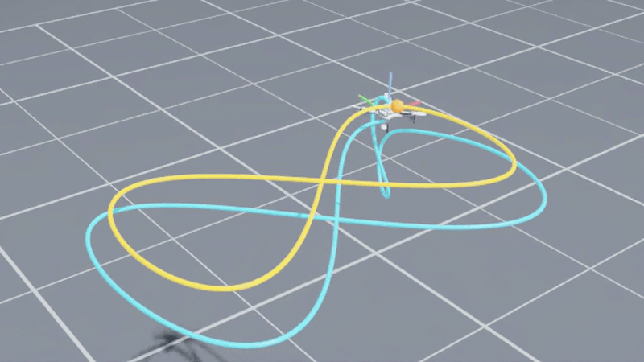

# Isaac-L2F

[](https://github.com/ruhalis/Isaac-L2F/actions/workflows/tests.yml)
[](pyproject.toml)
[](https://github.com/isaac-sim/IsaacLab)
[](LICENSE)

L2F-faithful quadrotor dynamics and RAPTOR-contract environments for
[NVIDIA Isaac Lab 3.0](https://github.com/isaac-sim/IsaacLab) on both Newton and PhysX.

<p align="center">
  
  <br>
  <em>The RAPTOR foundation policy flying a 6 s figure-eight in <code>Isaac-L2F-Hover-Direct</code>
  on Newton/MJWarp, replayed in Isaac Sim. Yellow: reference, cyan: flown path.</em>
</p>

[L2F](https://github.com/rl-tools/l2f) ("Learning to Fly in Seconds", rl-tools) is the
fastest quadrotor dynamics simulator and the training ground of the
[RAPTOR](https://github.com/rl-tools/raptor) foundation policy. It has no rendering and no
collisions. Isaac Lab has GPU rendering, collisions and obstacle scenes, but its own
multirotor support is PhysX-only and uses a different motor model. Isaac-L2F brings L2F's
exact motor and wrench model and the RAPTOR observation/action contract into Isaac Lab, so
that policies trained in L2F fly in Isaac Lab zero-shot, and vision policies can be trained
on top of the same dynamics.

## The contract

Everything in this package is written to one contract, the one RAPTOR and L2F use:

| | |
|---|---|
| Frames | body FLU (x forward, y left, z up), world z-up |
| Observation (22) | position − p_ref (3, world) · rotation matrix row-major (9) · linear velocity − v_ref (3, world) · angular velocity (3, body) · previous action (4, raw) |
| Action (4) | per-motor, normalised to [-1, 1], order front-right, back-right, back-left, front-left |
| Rate | 100 Hz (dt = 0.01 s), one RK4 step per control step |
| Quaternion | (w, x, y, z), body-to-world |

The reference `(p_ref, v_ref)` is an input with neutral defaults (origin, zero velocity); a
static setpoint has `v_ref = 0`. The previous action is the raw, unclamped action passed to
the last step, as the `l2f` oracle keeps it. Trajectory references, position-error clamps,
observation delays and noise schedules are downstream wrappers, not variants of the contract.

## What is here

`isaac_l2f.dynamics` is a pure-PyTorch, batched, device-agnostic port of the L2F model:

- parameter JSON schema (same keys as L2F / RAPTOR), load, save, stack, select
- first-order motor lag with separate rising and falling time constants
- thrust polynomial `c0 + c1 u + c2 u²`, rotor drag torque, arm moments
- RK4 step, post-integration, observation, reward, termination, initial-state sampling
- the RAPTOR domain-randomisation sampler (thrust-to-weight, torque-to-inertia, mass, size,
  time constants, torque constant, disturbance magnitude)
- `rotor_wrench(params, u, effectiveness)` returning the body-frame force and torque, which
  is what the Isaac Lab environment injects through the wrench composer; the optional
  per-rotor `effectiveness` `[N, 4]` scales a rotor's thrust and with it its reaction torque
  and arm moment (the hook fault schedules drive from downstream)
- world-frame disturbance force and body-frame disturbance torque on the state

`isaac_l2f.policy` is the policy protocol every env runs: `reset(mask)` / `step(obs) -> action`.
The policy owns its recurrent state and re-seeds the masked envs from its own `h0`; the hidden
size comes from the artefact. Loaders exist for TorchScript (a scripted module with
`forward(obs, hidden) -> (action, hidden)`, an `h0` buffer and a `hidden_size` attribute;
feed-forward policies use size 0) and ONNX (inputs `obs`, `hidden`; outputs `action`,
`hidden_out`; needs the `onnx` extra).

Upstream quirks are reproduced on purpose, not fixed: `J` and `J_inv` are stored
independently and used as loaded, the orientation cost is `2·acos(1 − |q_z|)`, and the
initial attitude angle ignores `max_angle`. Golden tests check every step against the
`l2f` pip package.

```python
import torch
from isaac_l2f.dynamics import load_registry, sample_initial_state, step, student_observation

params = load_registry("crazyflie").expand(1024)
gen = torch.Generator().manual_seed(0)
state = sample_initial_state(params, 1024, gen)
action = torch.zeros(1024, 4)
state = step(params, state, action)
obs = student_observation(params, state)   # [1024, 22], reference = origin / zero velocity

from isaac_l2f.policy import load_torchscript

policy = load_torchscript("student.pt")     # hidden size read from the artefact
action = policy.step(obs)                   # raw action; the env clamps
policy.reset(mask=torch.tensor([True] + [False] * 1023))   # re-seed env 0 only
```

## Install

Development (any platform, no GPU needed for the dynamics core and its tests):

```bash
uv sync
uv run pytest -q
```

With Isaac Lab 3.0 (Linux, NVIDIA GPU, Python 3.12). Isaac Lab ships as one distribution on
NVIDIA's package index with Newton included. The primary, kit-less path also pulls Isaac Lab's
kit-less PhysX, RTX and stage packages (`ovphysx`, `ovrtx`, `ovstage`), so both physics presets
and both renderers run without Isaac Sim:

```bash
uv sync --extra isaac
```

The Kit path installs full Isaac Sim 6.1 for USD/GUI workflows and importers; PhysX and RTX then
run through Kit. The two extras are mutually exclusive (Isaac Sim 6.1 pins `packaging==26.0`,
the kit-less PhysX package needs `packaging<24`), so switching is one sync either way:

```bash
UV_HTTP_TIMEOUT=1800 uv sync --extra isaacsim   # extension-cache wheels are multi-GB; uv's 30 s default times out
```

Kit-less training uses `physics=newton_mjwarp`; the PhysX preset is `physx`, Isaac Lab's auto
selector, which resolves to `ovphysx` without Isaac Sim and to `isaacsim_physx` under Kit; the
kit-less renderer selector is `ovrtx`. NVIDIA's index is a
regular extra index here (`unsafe-best-match`), as in NVIDIA's own pip instructions, because
Isaac Sim pins NVIDIA-built transitive packages that exist only there.

Two Linux-only rules that follow from the split lock:

- Pass the same extra to every `uv run` on that machine (`uv run --extra isaacsim python ...`,
  `uv run --extra isaac isaaclab train ...`) or use `uv run --no-sync`. A bare `uv run` re-syncs
  to the default extra set, which is a different resolver split (the Kit split pins
  `torch==2.11.0` and `numpy==2.3.1`; the kit-less and macOS splits take the latest), so it
  silently moves the venv off Isaac Sim's pins.
- Anything that imports `isaacsim` needs NVIDIA's EULA accepted non-interactively:
  `OMNI_KIT_ACCEPT_EULA=YES`. Export it in your shell profile on the box if you accept it.

## Acknowledgements

Dynamics model and parameter format from [rl-tools/l2f](https://github.com/rl-tools/l2f)
(MIT) and the RAPTOR pre-training code in [rl-tools](https://github.com/rl-tools/rl-tools).

## Citing

The GitHub sidebar's "Cite this repository" gives the entry for this package (from
[CITATION.cff](CITATION.cff)). Please also cite the L2F paper whose dynamics it ports, and
RAPTOR if you fly the foundation policy:

```bibtex
@article{eschmann2024learning,
  author  = {Jonas Eschmann and Dario Albani and Giuseppe Loianno},
  title   = {Learning to Fly in Seconds},
  journal = {IEEE Robotics and Automation Letters},
  year    = {2024},
  volume  = {9},
  number  = {7},
  pages   = {6336--6343},
  doi     = {10.1109/LRA.2024.3396025}
}

@article{eschmann2026raptor,
  author  = {Jonas Eschmann and Dario Albani and Giuseppe Loianno},
  title   = {RAPTOR: A foundation policy for quadrotor control},
  journal = {Science Robotics},
  year    = {2026},
  volume  = {11},
  number  = {114},
  pages   = {eaec1481},
  doi     = {10.1126/scirobotics.aec1481}
}
```

## License

MIT, see [LICENSE](LICENSE).
